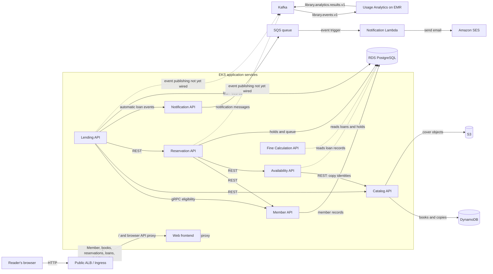
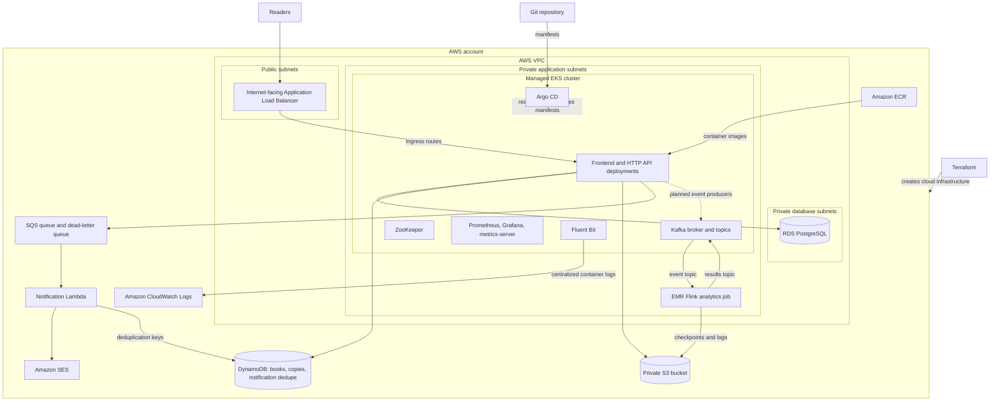

# Biblioteca : A Digital Library - System and Cloud Architecture

## 1. System overview

Biblioteca lets readers browse books, manage memberships, place holds,
borrow and return copies, and receive notifications. It is built as small
services: each service owns a clear responsibility and communicates with other
services through APIs or messages.

The project has seven HTTP APIs, a web frontend, and a separate Flink stream
processing job. In AWS, the APIs and frontend run on EKS. Data
uses PostgreSQL, DynamoDB, and S3. SQS and Lambda handle asynchronous
notifications, while Kafka and Flink provide the analytics path.

The dashed analytics arrows indicate planned connections, not an already
working producer path. The current service code does not publish reservation
or loan events to Kafka.

## 2. Microservice responsibilities

| Component | Responsibility | Main data or connections |
| --- | --- | --- |
| **Member** | Create and manage reader accounts; answer checkout eligibility checks. | Owns member records in PostgreSQL. Provides REST and a gRPC eligibility endpoint. |
| **Catalog** | Manage books, physical-copy identities, and cover images. | Owns book/copy records in DynamoDB and cover objects in S3. |
| **Reservation** | Place and cancel holds; keep a FIFO queue and assign available copies. | Owns reservation state in PostgreSQL. Checks Member and Availability over REST. Uses ZooKeeper locks in the cluster configuration. |
| **Lending** | Validate checkout and return operations; track due dates and idempotent returns. | Owns loan records in PostgreSQL. Calls Member by gRPC and Catalog and Reservation by REST. |
| **Availability** | Report copy states and counts without owning catalog, reservation, or loan records. | Reads copy identities from Catalog and loan/reservation state from PostgreSQL. |
| **Fine Calculation** | Calculate overdue fines from loan timestamps using the configured policy. | Reads Lending-owned loan records; does not own or modify loans. |
| **Notification** | Accept notification requests and deliver them asynchronously. | Uses an in-memory queue locally; in AWS, the API publishes to SQS and Lambda consumes messages and sends email through SES. |
| **Usage Analytics** | Aggregate library activity by book and one-minute event-time window. | Flink reads `library.events.v1` and writes `library.analytics.results.v1`. The job is submitted to EMR. |
| **Frontend** | Provide the reader-facing web interface and proxy browser API requests. | Node.js frontend proxies `/api/...` requests to the HTTP APIs. |

## 3. How services communicate

| Mechanism | Used for |
| --- | --- |
| **REST over HTTP/JSON** | Browser/API access and calls between Reservation, Lending, Availability, Catalog, and Member. |
| **gRPC** | Lending asks Member whether a reader is eligible to check out a copy. |
| **Kafka** | The analytics design streams reservation and loan events to Flink and publishes aggregate results to a separate topic. Event producers still need to be connected. |
| **SQS and Lambda** | Notification requests are queued and processed asynchronously. Failed messages can be retried and sent to a dead-letter queue. |
| **Database and object APIs** | Services access only the data stores needed for their work: PostgreSQL, DynamoDB, or S3. |

## 4. Cloud deployment architecture

The following layout is deployed on AWS. Actual verification and remaining
caveats are recorded in [FINAL_VERIFICATION.md](FINAL_VERIFICATION.md).

### Deployment flow

1. **Terraform** defines the VPC, EKS, RDS, DynamoDB, S3, messaging resources,
   Lambda, EMR, IAM roles, and ECR repositories.
2. **Build and publish** service images to ECR using the repository's image
   publishing script.
3. **GitOps**: Argo CD watches the Kubernetes manifests in Git and reconciles
   them onto EKS. Application changes are made through Git, not direct
   `kubectl apply`.
4. **Analytics**: build the Flink job and submit it to EMR separately. It is
   not an EKS deployment.

## 5. Why this design

- **Separate ownership** keeps membership, catalog, reservations, loans, and
  fines from silently changing one another's records.
- **PostgreSQL** fits related transactional data such as reservations and loans;
  **DynamoDB** fits book and copy lookups; **S3** fits cover images and analytics
  artifacts.
- **REST and gRPC** support direct request/response work. **SQS and Kafka**
  separate slower or streaming work from the reader-facing request.
- **EKS** hosts the stateless APIs and frontend. HPAs are configured for Catalog
  and Reservation; they scale pods based on CPU.
- **Flink on EMR** separates stateful stream processing from the API workloads.
  One-minute windows and checkpoints support time-based aggregates and job
  recovery.
- **Terraform and Argo CD** make infrastructure and Kubernetes changes
  repeatable and reviewable.
- **Private subnets, restricted security groups, private S3, and IAM roles**
  reduce direct exposure of data and cloud credentials.
- **Prometheus/Grafana and Fluent Bit/CloudWatch** provide metrics, dashboards,
  and centralized container logs.

## 6. Current implementation notes

- The app is deployed. `python demo.py` presents its REST/storage, gRPC,
  ZooKeeper, fine, notification, Prometheus, Flink and HPA checks one function
  at a time, waiting for Enter before each step.
- The ALB routes `/` to the frontend and browser API calls use its `/api/...`
  proxy. Services retain their internal `/members`, `/books`, `/loans`, etc. paths.
- EKS uses one t3.xlarge worker and EMR uses one m5.xlarge primary: 8/8 vCPUs.
  HPAs scale Catalog/Reservation pods from 1 to 2 and back; no node autoscaler is
  configured. Git omits their replica counts so HPA decisions are preserved.
- Seven APIs expose metrics. Prometheus/Grafana and aggregated CloudWatch logs
  are operational; see [MONITORING.md](MONITORING.md).
- LoanIssued/LoanReturned notifications are best-effort after commit, use stored
  member emails and stable IDs, and deliver through SQS/Lambda/SES. Publishing
  failures do not fail the committed transaction; no durable outbox is present.
- The real Flink job passed isolated Kafka fixtures and checkpoint/output checks.
  Default topics are `library.events.v1` and `library.analytics.results.v1`;
  Lending/Reservation domain publishers are not implemented. The shared event
  envelope and Flink's snake_case fields need alignment before connecting them.
- API deployments use Argo CD. Historical bootstrap/monitoring direct applies
  remain a strict GitOps caveat. Bounded load tests do not prove business API
  capacity or failover. The fine fixture does not backdate production loans.
- Local Compose runs APIs/storage emulators. Kafka/Flink are separate.
