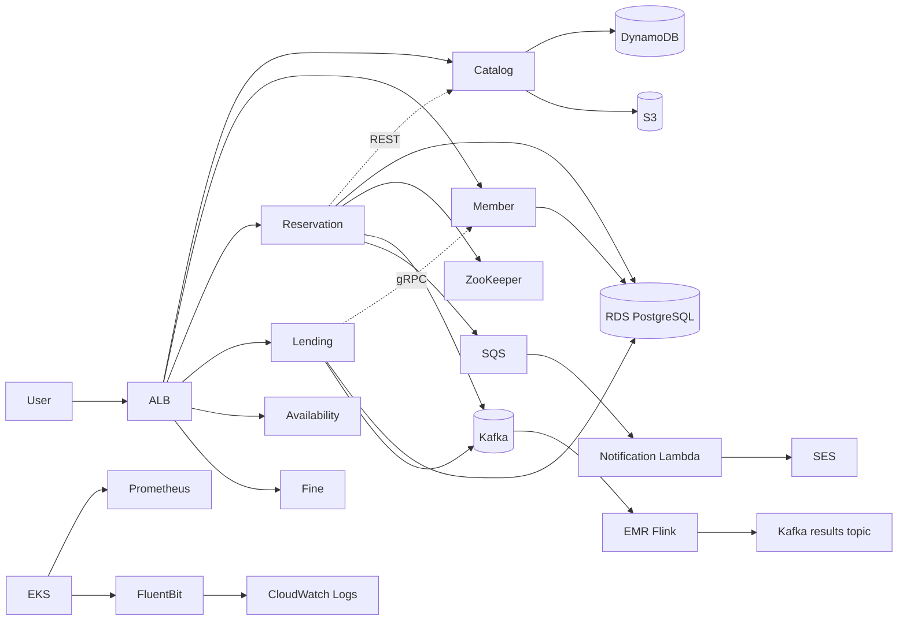

# Digital Library Final Architecture

## System overview

The Digital Library is an eight-service application for managing books,
physical copies, members, reservations, lending, availability, fines,
notifications, and usage analytics. The cloud profile runs stateless APIs on
Amazon EKS, uses a Lambda/SQS notification path, and runs the stateful Flink
analytics job on Amazon EMR.

## Service responsibilities

| Service | Responsibility | Primary interface/data |
| --- | --- | --- |
| Catalog | Book metadata and physical-copy identities | REST, DynamoDB, S3 |
| Member | Member records and checkout eligibility | REST and gRPC, PostgreSQL |
| Reservation | FIFO reservation queue and copy allocation | REST, ZooKeeper, PostgreSQL, Kafka/SQS events |
| Lending | Checkout, return, and loan lifecycle | REST, gRPC, PostgreSQL |
| Availability | Read model of available copies | REST, Catalog API, PostgreSQL projection inputs |
| Fine Calculation | Idempotent overdue-fine calculation | REST, Lending loan records |
| Notification | Asynchronous member notices | SQS-triggered Lambda and SES |
| Usage Analytics | Stateful one-minute event-time aggregation | Kafka input/results topics, EMR/Flink |

## Communication mechanisms

- **REST:** public API calls and service calls such as Lending to Reservation
  and Availability to Catalog.
- **gRPC:** Lending calls the Member `CheckoutEligibility` contract in
  `contracts/proto/member_eligibility.proto`. The Member service exposes the
  contract on port 50051 when `GRPC_PORT` is configured.
- **SQS:** notification events are queued durably, retried, and moved to a
  dead-letter queue after repeated failures.
- **Kafka:** reservation and lending events are published to
  `library.events.v1`; Flink publishes aggregates to the separate
  `library.analytics.results.v1` topic.

## Persistence and ownership

- RDS PostgreSQL is the transactional source of truth for members,
  reservations, loans, fines, and outbox records.
- DynamoDB stores catalog records and high-read analytics/availability
  projections.
- S3 stores private covers, EMR logs, Flink checkpoints, and job artifacts.
- ZooKeeper is coordination only. PostgreSQL constraints and transactions
  remain the final correctness guard against double allocation.

## Cloud deployment

Terraform in `infra/` owns the VPC, public/private/database subnets, EKS,
managed node group, RDS, DynamoDB, S3, SQS/DLQ, Lambda, IAM/IRSA, and EMR.
Argo CD Applications in `argocd/` reconcile the application and platform
Kustomize trees. The application tree contains the seven stateless API
Deployments, two HPAs, and the ALB Ingress. The platform tree contains the
Kafka broker, three-node ZooKeeper ensemble, metrics-server, Prometheus/Grafana
installation, and Fluent Bit.

The Notification API in Compose is a local adapter only. The cloud service is
the Terraform-managed Lambda, so the serverless requirement is met without
running a second cloud notification Deployment.

## Scaling and observability

Catalog and Reservation scale from two to six replicas at 60% CPU through
`autoscaling/v2` HPAs. `scripts/k6/reservation-load.js` creates sustained
catalog and reservation traffic and asserts latency/error thresholds.

Prometheus scrapes `/metrics` from the APIs. Grafana provides RPS, error-rate,
p95 latency, HPA, and cluster CPU panels. Fluent Bit forwards container logs to
CloudWatch; Lambda and EMR logs are retained in their respective AWS logging
destinations.

## Requirement traceability

| Assignment item | Evidence |
| --- | --- |
| a | Terraform resources in `infra/` |
| b | Lambda/SQS, REST APIs, gRPC contract and implementation, Kafka |
| c | EKS, `k8s/hpa.yaml`, k6 script |
| d | Argo CD Applications and Git-tracked Kustomize |
| e | Java Flink job, EMR Terraform, two Kafka topics |
| f | ZooKeeper StatefulSet and copy-lock coordinator |
| g | RDS, DynamoDB, and S3 |
| h | Prometheus/Grafana and Fluent Bit/CloudWatch |

